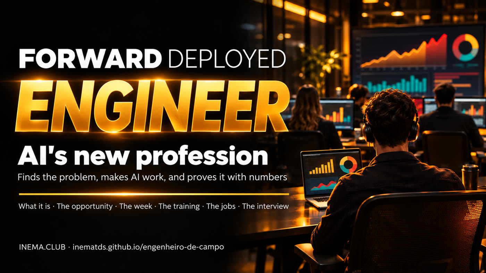

# AI forward deployed engineer: the new profession and the kit to get ready

[](https://linnoff88-dev.github.io/

**🇧🇷 [Português](README.md) · 🇺🇸 [English](README.en.md) · 🇪🇸 [Español](README.es.md)**

## What it is

**AI forward deployed engineer** (FDE) is the professional an AI company sends to work inside a customer’s organization: they uncover the real problem, build the solution together with the team, prove it works with a measured test (eval), and get people to use it. This kit is free training to help you prepare: a test to find out which half you’re missing (builder or trusted by the customer), a learning path, a simulated customer to practice discovery, a one-page scope with a validator, an eval that runs on your computer, a proof project outline, a job map, and interview practice. It all runs locally, with no API and no model installation.

## 📖 User guide

Complete guide (what it is, its potential, step-by-step training): **https://linnoff88-dev.github.io/

Browser test, 3 minutes: **https://linnoff88-dev.github.io/ (in Portuguese)

## Start by asking your AI

Open Claude Code or Codex in a new folder and paste:

```
Read the "AI forward deployed engineer" kit at https://github.com/linnoff88-dev/engenheiro-de-campo (the README explains everything).
Then help me prepare for this profession, in plain English:
1. Take the "which half do you have" test with me, one question at a time, and tell me the result.
2. Build a 4-week plan focused on my weaker half, using the kit’s steps.
3. Start with the first exercise in the plan with me.
Don’t install or change anything on my computer without showing me first and waiting for me to say yes.
```

## Why this role exists

Companies buy AI faster than they can make it work in their messy systems. Instead of handing over a password and wishing them luck, the AI company sends an engineer to sit alongside the customer: they don’t sell hours of work or software; they deliver an outcome. People with **both halves** are rare: the builder and the person the customer trusts.

## Based on official job listings (checked on 11/20/2026)

- **OpenAI**, *Forward Deployed Engineer (FDE) - SF* listing: published range "$185K – $300K • Offers Equity". [Job listing](https://jobs.ashbyhq.com/openai/967f94aa-1706-4dba-ac89-bfbc2c38b688) · record in [`fontes/vaga-openai.json`](fontes/vaga-openai.json) (in Portuguese).
- **Anthropic**, *Forward Deployed Engineer* and *Staff Forward Deployed Engineer* listings: deliver "MCP servers, sub-agents, and agent skills", "identify and codify repeatable deployment patterns", arrive "with only a business problem and leave with a defensible technical strategy". [FDE listing](https://job-boards.greenhouse.io/anthropic/jobs/5391021008) · [Staff listing](https://job-boards.greenhouse.io/anthropic/jobs/5449229008) · record in [`fontes/vagas-anthropic.json`](fontes/vagas-anthropic.json) (in Portuguese).
- **The market beyond OpenAI:** official forward deployed engineer job postings list annual salaries ranging from US$ 135K (Palantir) to US$ 415K (Cohere), with Anthropic, Harvey, Ramp, Databricks, and Scale AI in between. There are open roles with Brazil in the location: Decagon (remote, requires Portuguese, Spanish, and English), Cognition (on-site in Sêo Paulo), and Databricks (FDE Brazil). Salesforce says on its own blog that it will build a team of 1,000 forward deployed engineers. The 23 items, with the exact wording, link, and source type (official job posting, official blog, or press), are in [`fontes/mercado.json`](fontes/mercado.json) (in Portuguese).

Job listings change: always check the official page.

---

## The process, start to finish

Who does what: 🧠 session (you, with AI alongside) · ⚙️ kit script · 🤖 `claude -p` (or Codex) through your subscription.

| # | Step | Command / file | Who |
|---|---|---|---|
| 1 | Find out which half you have | `python3 kit/1-teste-metade/teste_metade.py` (or the `teste-metade.html` page) | ⚙️ |
| 2 | Follow the path, one practice per item | [`kit/2-trilha/TRILHA.md`](kit/2-trilha/TRILHA.md) (in Portuguese) | 🧠 |
| 3 | Practice discovery with the simulated customer (4 industries) | paste a block from [`kit/3-cliente-simulado/PROMPTS.md`](kit/3-cliente-simulado/PROMPTS.md) (in Portuguese) into the AI; check against the [checklist](kit/3-cliente-simulado/CHECKLIST-DESCOBERTA.md) (in Portuguese) | 🤖 + 🧠 |
| 4 | Write a one-page scope and validate it | copy [`modelo.md`](kit/4-escopo-1-pagina/modelo.md) (in Portuguese) → `python3 kit/4-escopo-1-pagina/validar_escopo.py meu-escopo.md` | 🧠 + ⚙️ |
| 5 | Run the sample eval, then your own | `python3 kit/5-eval/rodar_eval.py --comparar kit/5-eval/automacao_v1.py kit/5-eval/automacao_v2.py` | ⚙️ |
| 6 | Proof project with a real customer + case study | [`kit/6-projeto-prova/ROTEIRO.md`](kit/6-projeto-prova/ROTEIRO.md) (in Portuguese) + [`MODELO-ESTUDO-DE-CASO.md`](kit/6-projeto-prova/MODELO-ESTUDO-DE-CASO.md) (in Portuguese) | 🧠 |
| 7 | Search for jobs | [`kit/7-vagas/VAGAS.md`](kit/7-vagas/VAGAS.md) (in Portuguese) | 🧠 |
| 8 | Practice the interview (case, project, technical, behavioral) | paste the prompts from [`kit/8-entrevista/ENTREVISTA.md`](kit/8-entrevista/ENTREVISTA.md) (in Portuguese) into the AI | 🤖 + 🧠 |
| 9 | Understand the workweek | [`kit/9-semana/SEMANA.md`](kit/9-semana/SEMANA.md) (in Portuguese) | 🧠 |

---

## Technical setup

### Prerequisites

- Python 3.8 or newer (standard library only; nothing to install with `pip`).
- Git, to download the kit. No API key or local model required.

```bash
git clone https://github.com/linnoff88-dev/engenheiro-de-campo.git
cd engenheiro-de-campo
```

### Commands

```bash
# 1. "which half do you have" test (interactive, or with the number of the option you picked in each of the 12 questions)
python3 kit/1-teste-metade/teste_metade.py
python3 kit/1-teste-metade/teste_metade.py --respostas 3,3,2,3,2,3,1,1,2,0,1,2
#    regenerate the page after changing perguntas.json
python3 kit/1-teste-metade/gerar_pagina.py

# 4. validate a scope (0 = approved, 1 = rejected)
python3 kit/4-escopo-1-pagina/validar_escopo.py kit/4-escopo-1-pagina/exemplo-preenchido.md
python3 kit/4-escopo-1-pagina/validar_escopo.py kit/4-escopo-1-pagina/exemplo-reprovado.md

# 5. eval: one version, compare two, new cases, minimum score
python3 kit/5-eval/rodar_eval.py kit/5-eval/automacao_v1.py
python3 kit/5-eval/rodar_eval.py --comparar kit/5-eval/automacao_v1.py kit/5-eval/automacao_v2.py
python3 kit/5-eval/rodar_eval.py --casos kit/5-eval/casos-novos.json kit/5-eval/automacao_v2.py
python3 kit/5-eval/rodar_eval.py kit/5-eval/automacao_v2.py --minimo 0.9
```

### Sample eval, measured on 11/20/2026

| | `casos.json` (30) | `casos-novos.json` (10) |
|---|---|---|
| `automacao_v1.py` (simple keyword matching) | 18/30 | 4/10 |
| `automacao_v2.py` (fixed based on v1 failures) | 30/30 · 12 fixed, 0 broken | 4/10 |

v2 memorized the cases used to fix it; on new cases, it performed the same as v1. That’s the kit’s lesson: a serious eval always has a separate set. To evaluate your agent, copy [`automacao_meu_agente.py`](kit/5-eval/automacao_meu_agente.py) (in Portuguese) and read [`kit/5-eval/LEIA.md`](kit/5-eval/LEIA.md) (in Portuguese).

The scope validator accepts section headings in Portuguese, English, and Spanish (`Problema`/`Problem`, `O número`/`The number`/`El número`, `Pronto quando`/`Done when`/`Listo cuando`, `Fora do escopo`/`Out of scope`/`Fuera del alcance`).

### Files

```
kit/1-teste-metade/     perguntas.json (single source of truth), teste_metade.py, gerar_pagina.py, teste-metade.html
kit/2-trilha/           TRILHA.md
kit/3-cliente-simulado/ PROMPTS.md (4 industries), CHECKLIST-DESCOBERTA.md
kit/4-escopo-1-pagina/  modelo.md, exemplo-preenchido.md, exemplo-reprovado.md, validar_escopo.py
kit/5-eval/             casos.json, casos-novos.json, automacao_v1.py, automacao_v2.py, rodar_eval.py, automacao_meu_agente.py, LEIA.md
kit/6-projeto-prova/    ROTEIRO.md, MODELO-ESTUDO-DE-CASO.md
kit/7-vagas/            VAGAS.md
kit/8-entrevista/       ENTREVISTA.md
kit/9-semana/            SEMANA.md
fontes/                  checked official listings (URL, literal text, date)
guia/                    PT + en/ + es/ pages
tests/                   automated tests
```

### Tests

```bash
python3 -m unittest discover -s tests -v
```

31 tests cover: the which-half test (12 questions, 6 per half, all 3 possible results, tie within margin, invalid answers, page with same questions as JSON), the scope validator (approved example, rejected example and template, no number, only one number, no quotes, missing section, EN/ES headings, exit codes), and the eval (well-formed cases, measured scores 18/30, 30/30, and 4/10, comparison with 12 fixed and 0 broken, automation that crashes counts as a failure, `--minimo` exit code, agent model does not run unless configured), and the numbers policy: only figures that appear in the text of a job posting or official blog recorded in `fontes/` (the OpenAI range must match the recorded one), the only press percentage must always have its source (Fortune, with Lightcast data) alongside it, and the market section links must be identical in all three languages and all recorded in `fontes/`.

## License

MIT. Open and free content from [ARCKHÉ AI](https://ARCKHÉ AI).